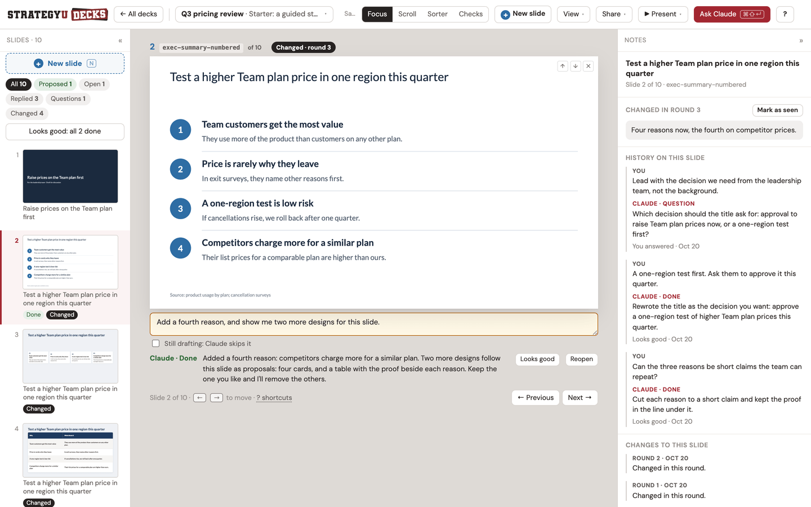
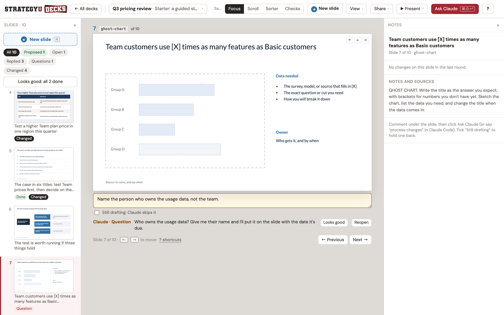
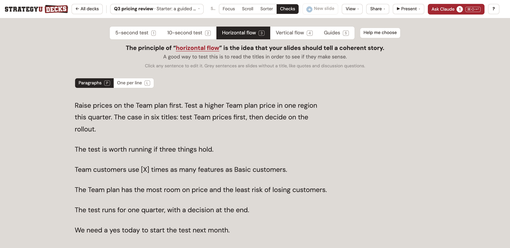
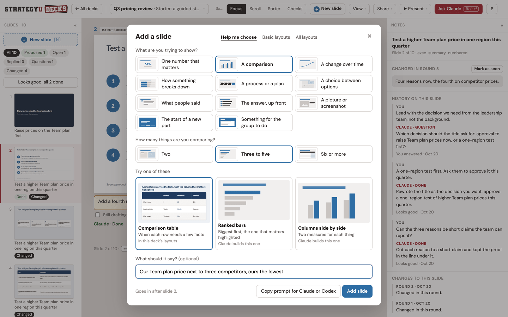
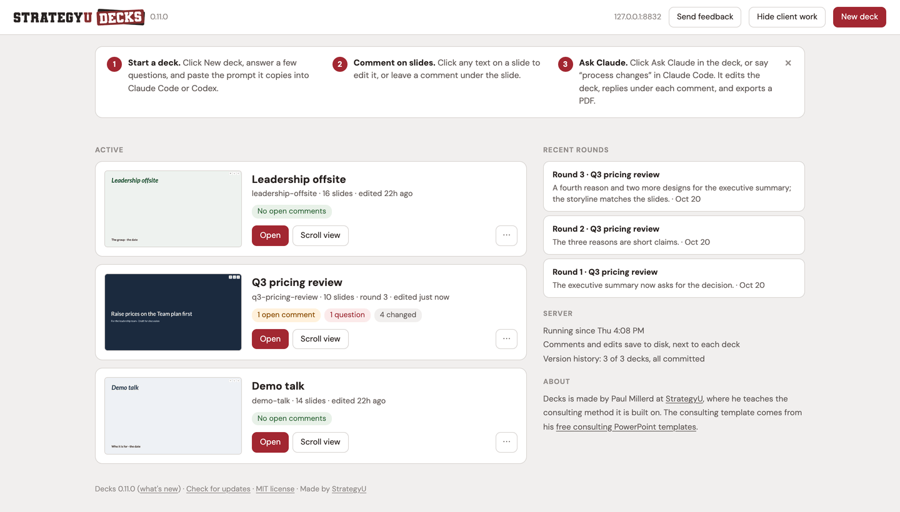

# Decks

Make slides by commenting on them. You leave a comment under a slide, your coding agent
(Claude Code or Codex) changes the deck, and it replies on the slide: what it did, a
question for you, or why it left something alone.

To try it, paste the prompt under [Get started](#get-started) into Claude Code or Codex.



## Why I built this

I teach people consulting skills and a big part of my work is getting people to make
better and more compelling decks in PowerPoint. I made most of my slides in PowerPoint
too. Of course I did, I'm a former consultant.

With Astra and Opus 5.5, we've reached a tipping point. I think that bulky software like
Google Slides and PowerPoint increasingly doesn't make sense, especially for a solo
operator like me. Handling basic formatting is trivial now and you can play project
manager or partner, with the latest models as your Senior Associate. While I assume this
may continue to evolve and I'm sure Claude's slide project may eventually kick my ass,
for now, I am putting this out there as a simple harness that you can open in Claude or
Codex and work in iteratively.


Decks is built that way. You say what should change, your agent changes it, and it tells
you on the slide what it did and why. I have a tab, **Checks**, that offers some of the
tests I teach to teams and also still run on my own slides: five- and ten-second tests,
title tests, and horizontal and vertical flow. You can use AI as both a doer and a
teacher, so you learn the method and apply it at the same time, on your own work.

When I make slides now, this is my daily driver and harness. I'm not sure I'll ever align
boxes in PowerPoint again.

## A builder with a strong opinion

Decks is built on the ideas I teach at StrategyU, and the agent follows them every time it
writes or fixes a slide:

- **Answer first.** Lead with the recommendation, then the evidence. Build up to it only
  when the audience is skeptical.
- **Ghost deck first.** Write every title, in order, before building a single slide. It's
  the cheapest moment to fix the story. ([Ghost decks](https://strategyu.co/ghost-deck/))
- **Action titles.** Every title is a full sentence that says the point: "Q3 revenue grew
  22%, driven by enterprise expansion", not "Q3 Revenue".
  ([Action titles](https://strategyu.co/action-titles/))
- **Vertical flow.** The title matches the content: the body proves the title, and there's
  no takeaway box at the bottom.
  ([The principles of flow](https://strategyu.co/persuasive-powerpoint-storytelling-principles-of-flow/))
- **Horizontal flow.** Read only the titles, in order, and they tell the whole story.
- **The five-second test.** For a slide you present: glance at it for five seconds, and
  the one point comes through.
- **The ten-second test.** For a slide people read: they can take it in within ten
  seconds. One point, a clear hierarchy, a chart that reads without study.
  ([The ten-second test](https://strategyu.co/ten-second-test/))
- **"So what?"** A slide can be easy to read and still say nothing. Every slide tells the
  audience what to think. ([Pretty slide syndrome](https://strategyu.co/pretty-slide-syndrome/))
- **One idea per slide.** If it needs "and also", it's two slides.
- **Charts prove the title.** Bars, columns, and lines; the number that matters stands
  out; never a pie chart.
- **Draw the relationship.** No grids of identical boxes. Show the process, the spectrum,
  or the chart instead.

Most of these are one keypress away in **Checks**. The agent's version of the method is
in `.claude/skills/decks/SKILL.md`, and the full one is in my
[strategy-slides skill](https://strategyu.co/strategy-consulting-aiskills/).

## Recommended setup

I use Decks in the Claude and Codex apps, with the deck open in the app's built-in
browser, so the agent and I look at the same page. Models: Opus 5.5 or Sol 6.1. I haven't
tried others yet.

## Get started

Paste this into Claude Code or Codex. It installs Decks, opens it, and starts your first deck
with you.

```text
Set up Decks for me: https://github.com/paulmil11/decks

1. Clone it into ~/decks and run ./setup.sh there.
2. Start the server with python3 server.py and keep it running. Open
   http://localhost:8790 in your built-in browser so we're looking at the same page.
3. Read AGENTS.md in that folder and follow it from here on.
4. Ask me what I'm making, who it's for, and the one point they should leave with.
   Make the deck with ./sb new, then show me every slide title in order before you
   build any slides.
```

From then on, leave comments under the slides and say "process changes" (or click **Ask
Claude** in the deck for a prompt to paste). To install by hand instead, see
[Install](#install).

## Each deck is one file on your machine

Each deck is one HTML file in its own folder, with its own git history. It opens in any
browser, presents full screen, and prints to PDF. Decks runs on your machine and keeps
nothing anywhere else (your agent sends what it reads to its model provider, as it does
with any file). When you need to send a deck, **Client copy** gives you one file with
only the slides.

## Install

You need Python 3.9 or newer, Node.js 18 or newer, and git (optional, but decks get
version history with it). macOS and Linux.

```bash
git clone <this repository> decks
cd decks
./setup.sh
python3 server.py
```

Open http://localhost:8790/. The first start makes `~/slide-decks/` with the deck
registry (`decks.json`) and a demo deck to practice on.

The server needs only Python. Screenshots, the audit, PDF export, and dashboard
thumbnails use Node.js and a headless Chrome. `setup.sh` installs `playwright-core` into
`tools/` and, if it can't find a usable Chrome, Playwright's Chromium (about 150 MB, in
`~/Library/Caches/ms-playwright` on macOS or `~/.cache/ms-playwright` on Linux). On
Linux, if screenshots or PDFs fail, Chrome is missing system libraries:
`(cd tools && sudo npx playwright-core install-deps chromium)`.

### Updates

Decks has numbered versions. [CHANGELOG.md](CHANGELOG.md) says what changed in each, and the
dashboard shows the version you're running, next to its name. When a new version is out, the
dashboard says so, and `?` in a deck gets a dot and a line about it. **Check for updates** (in
the dashboard footer, or `?` in a deck) asks GitHub right away instead of waiting for the next
check.

To update, click **Copy update prompt** on that note and paste it into Claude Code or Codex: it
pulls the new version, restarts the server, and checks the version. Or run `git pull` here and
restart the server yourself. To hear by email, watch the repository on GitHub
(Watch › Custom › Releases).

To know about new versions, the server asks GitHub every six hours which release is newest
(and again ten minutes later if GitHub couldn't be reached): one small request, read from a
redirect. GitHub sees your IP address and that a check happened.
Nothing about your decks is sent. To turn it off, set `"check_updates": false` in
`config.json`, or `SB_CHECK_UPDATES=0`. Check for updates still asks when you click it.

### Settings

Defaults: port 8790, listening on 127.0.0.1, decks in `~/slide-decks`. To change them,
copy `config.example.json` to `config.json`, or set environment variables (they win):

| Setting | `config.json` | Environment |
|---|---|---|
| Port | `port` | `SB_PORT` |
| Address to listen on | `host` | `SB_HOST` |
| Decks folder (also holds `decks.json` and `settings.json`) | `decks_dir` | `SB_DECKS_DIR` |
| Ask GitHub every six hours for new versions (`true`) | `check_updates` | `SB_CHECK_UPDATES` |
| A different config file | | `SB_CONFIG` |
| Where `sb` finds the server | | `SB_URL` |
| Chrome for the headless jobs | | `SB_CHROME` |
| Keep one headless Chrome open between jobs (`0` turns it off) | | `SB_BROWSER_WORKER` |

`python3 server.py --port 8799` changes the port for one run.

## How a round works

1. **You comment.** Write what should change in the box under a slide, or click any text
   on the slide and fix it yourself. It saves to disk next to the deck as you type.
2. **You hand it to the agent.** Click **Ask Claude** in the top bar (or press ⌘⇧↵). It copies a prompt
   with the deck file and the steps; paste it into Claude Code or Codex. With the `decks`
   skill installed, you can just say "process changes".
3. **The agent edits and replies.** It reads your comments and edits with `sb comments`
   and `sb edits`, changes the deck file, and answers each comment on its slide with
   `sb reply`. You see "Claude working" on the slide while it goes.
4. **The agent checks its work.** It screenshots the slides it touched, runs the audit,
   exports the next numbered PDF, records the round, and commits the deck folder.
5. **You review.** The page reloads once you stop typing. Replies sit under their slides,
   and changed slides carry a badge. **Looks good** clears a comment; **Reopen** sends it
   back.

Each slide keeps its history in the side panel: every comment, the agent's reply, and
how it ended.



### Watch mode: start each round with one click (Claude Code)

Instead of typing "process changes" every time, say this once in Claude Code:

```text
Watch my decks.
```

Claude starts `sb watch` in the background and waits on every deck (name one to watch only
that deck). In each deck, **Ask Claude** turns into **Process now**. When your comments are
ready, click it or press ⌘⇧↵: the round starts in that Claude Code chat, and you follow it in
the deck as usual. When the round is done, Claude goes back to watching. Say "stop watching"
to end it.

A click while Claude is busy shows **Queued…** and starts the next round as soon as it's free.
If nothing is watching, the button goes back to Ask Claude and copies the prompt. Watch mode
is built for Claude Code. Codex hasn't been tested with it yet; there, use Ask Claude.

## Checks: the tests I teach, one key each

Press C, or a number key from any view to run that check on the slide you're on. Not sure
which? **Help me choose** asks what you want to know and opens the check that answers it.

1. **5-second test.** Can you get the point of the slide at a glance?
2. **10-second test.** Can a reader take it in, in the time they'll give it? A miss on
   either timed test (M) leaves a comment on the slide for the next round.
3. **Horizontal flow.** The titles alone, in order, as paragraphs or one per line. They
   should tell the whole story. You can edit them right there.
4. **Vertical flow.** The title first, with the body hidden. Say what the slide has to
   prove, then press Space and check that it does. It finds the title wherever your layout
   puts it, even inside a column or panel.
5. **Guides.** Four basic rules drawn on every slide, with a list of the slides that
   break one:
   - the protected border, kept for the logo, source line, and page number;
   - titles of two lines at most (title, section, closing, and statement slides are
     exempt);
   - no text under 12 px on the 1000 px slide;
   - no more than four text sizes on a slide.

   They're guidelines. They flag problems and never block you. **Ask Claude to fix** adds
   what a slide breaks to its comment (**Comment on all** does every flagged slide), and
   the agent fixes it next round. `sb audit` runs the same check, plus overflow and
   overlapping labels.

You can comment from any check except the timed tests: the comment box stays under the
slide.



### Proposed slides

Sometimes the agent has another take on one of your slides: a redraw, a different layout, a
tighter version. It doesn't replace yours. It adds the new one right after it, as a proposal,
or several options for one slide when the choice is real.

- Under the proposal, **Accept** (A) puts it in your original's place, and **Keep original**
  (K) takes it out. Both apply to the version on screen at once, and U undoes.
- Above it, **Original | Proposed** (Space) flips between the two in the same spot, and the
  notes panel shows the original next to the agent's note on what's different. With several
  options it reads **Original | Option 1 | 2 | 3**: Space flips through them (Shift+Space goes
  back), Accept takes the option on screen, and the others go.
- The **Proposed** filter on the left goes through the slides you haven't decided yet.
- To ask for a change instead, write it in the proposal's comment box.

At the next round the agent writes your decisions into the deck file with
`sb proposals <deck> --bake`: an accepted proposal takes the original's place in every version
and the original moves to the extras; a rejected one, or an option that lost, is deleted (git
keeps it). Two options accepted for one slide are left for you to settle. It checks the deck
afterward and puts the file back if anything is off.

## Working in a deck

Four views, each with the slides on the left and the notes on the right:

- **Focus** (F): one slide, its comment box, and the agent's reply.
- **Scroll** (S): the whole deck, with comments and replies under each slide.
- **Sorter** (G): drag thumbnails to reorder, × to leave a slide out, and a shelf to bring
  slides back.
- **Checks** (C): above.

The top bar keeps the rest in a few places:

- **The deck's name** shows the version on screen. Click it to switch versions (say, the full
  deck, a short cut, and a facilitator pack), which share slides.
- **View**: Titles only (H) hides everything but the titles, in any view. Switches for the
  slide list ([), the notes panel (]), and facilitator notes under each slide in Scroll. And
  **What changed, round by round**: each round's summary, the slides it changed with what
  changed on each (click one to open it), the proposals you accepted or kept in it, its PDF and
  its commit, newest first. A slide's notes panel lists every round that changed it.
- **Share**: Download PDF (the slides as they look now, one landscape 16:9 page each, made by the
  server so the print window's paper settings can't turn it sideways), Print, and the three copies below.
- **Present**: full screen from the slide you're on (⌘↵), or presenter view.
- **Ask Claude** (⌘⇧↵, Ctrl+Shift+Enter): the one red button. It's Process now in watch mode,
  and the shortcut works while you type a comment.
- **?**: how this works, every shortcut, and the plain deck file.

### Add a slide

Press N, click **New slide** in the top bar or the filmstrip, or click the + between two
slides. **Help me choose** asks what you're trying to show and suggests layouts. **Basic
layouts** and **All layouts** show what the deck carries. **Add slide** puts one where you
clicked; **Copy prompt** hands your agent a layout the deck doesn't have yet.

Every deck carries guided basic layouts (`templates/_engine/basics.js`): a big number,
points, two columns, a process, a table, quotes, a section divider, a question, an
exercise, and three picture layouts. Click a picture, or drop an image file on it, to put
your own in. It's saved next to the deck.



### Sending a deck out, and getting feedback back

**Share** in the top bar has three copies, each one file with its pictures inside:

- **Client copy**: for people who read or present it. The version on screen, slides only,
  as they look now. Notes, comments, facilitator slides, other versions, and editing are
  left out, so they aren't in the file's source either. It scrolls, prints one slide per
  page, and presents full screen (P).
- **Review copy**: for someone outside, a client say, who should comment and edit and send
  it back. The version on screen with editable text, a comment box under each slide, and
  "Save a copy with my edits". Your notes, your comments, facilitator slides, and the
  other versions are left out of its source.
- **Editable copy**: the whole deck with its notes and comments, for you. Never send it to
  a client.

When the reviewer sends their saved file back, run `sb import <deck> <file.html>` (add
`--dry-run` first to see what would come in). Their comments merge in slide by slide,
under any comment already there; their text and slide order win where they changed them
(`--keep-mine` keeps yours instead). Then process changes as usual. The state before each
import is kept in `.slidebuilder/imports/`.

`sb export` prints the deck file to PDF. If the browser holds edits that aren't in the
file yet, it says so; `--with-edits` prints what the browser shows instead.

### Two tabs and a dropped connection don't lose your work

Each save carries what the page started from, and the server merges it with anything
another tab saved in the meantime. Two tabs on the same deck keep both sets of changes,
and the other tab offers a reload. A save that fails stays in the browser and is retried
until the server answers.

## Starting a deck

Click **New deck** on the dashboard. First, a name, what you're making (a presentation, a
training, a talk, a proposal, or a blank deck), and any pieces to build alongside it, like
a facilitator pack or a short version. Then who it's for, what they know, and the one
point they should leave with, plus optional length, structure, density, and notes. Last,
how it looks: a sample slide in each color set, the title font, and your logo if you want
one on every slide.

**Create deck** sets up the folder and its git history, writes your brief to `BRIEF.md`,
copies a prompt for your agent, and opens the deck. Paste the prompt, and the agent builds
the first draft from your brief.

From the command line:

```bash
./sb templates
./sb new "Q3 pricing review" --template consulting --audience "The leadership team" \
  --point "Raise prices on the middle tier first." --style Navy
```

Templates (`templates/<id>/`):

| Template | What it is |
|---|---|
| `consulting` | A guided storyline in eight slides: cover, executive summary, storyline, hypothesis tree, ghost chart, 2x2, plan, and next steps. Every line says what goes there. Built from my [free consulting PowerPoint templates](https://strategyu.co/strategy-consulting-powerpoint-templates/) (100+ slides). |
| `talk` | An opening, three parts with dividers, and a close |
| `workshop` | A training day: agenda, modules, practice, breaks, and a facilitator pack |
| `proposal` | Situation, approach, team, fees, and next steps |
| `blank` | A title, one part, two slides, and a close |

Colors: Navy, Dark, Minimal, Forest, Teal, or Plum, with serif or sans serif titles.
They're written into the deck as one `<style id="deck-theme">` block, so you can restyle
the whole deck in one place. Set text and background colors on `.slide, .slide-frame` there,
not on `:root`, as the Dark theme does: they belong to the slides, and the editor around
them keeps its own. Upload a logo and it goes in the corner of every slide.

### Importing a deck you already have

**Import a deck**, at the bottom of New deck's first step, brings in a PowerPoint file or a
PDF. From Keynote or Google Slides, export to PowerPoint first. Choose the file (or paste its
path), then pick how it comes in:

- **Keep its look.** Every slide is converted as it is, so every word on it can be edited,
  and its speaker notes come along. Charts, SmartArt, and icons come in as pictures cut from a
  PDF of the deck. A PDF on its own works too: each page keeps its look, and its words come
  back as text you can edit.
- **Rebuild it in Decks' layouts.** The same slides in the same order, with your words and
  notes, laid out in Decks' own layouts and the colors you pick next.

**Import deck** puts the file in the deck's `source/` folder, writes the steps for your agent
to `BRIEF.md`, and copies a prompt. Paste it into Claude Code or Codex. The agent runs
`tools/importdeck.py`, which needs four Python packages (python-pptx, lxml, Pillow, and
PyMuPDF); it asks you before installing them. A PowerPoint file comes in best with a PDF of
the same deck next to it in `source/` (in PowerPoint, File › Export › PDF): the charts and
icons are cut from it, and every slide gets a picture of the original to compare with, behind
its "original" button. If LibreOffice is installed, the tool makes the PDF itself.

From the command line:

```bash
./sb new "Q3 pricing review" --from "~/Downloads/Q3 pricing review.pptx"
./sb new "Q3 pricing review" --from "~/Downloads/Q3 pricing review.pptx" --rebuild --style Navy
```

This is different from `sb import`, which brings a reviewer's returned file back into a deck.

## The dashboard



Every deck with its open comments, latest PDF, and recent rounds. The ⋯ on a deck hides
it (Show brings it back from the Hidden list at the bottom) or deletes it. Delete moves a
deck this app made to the Trash. A deck you registered from a folder of your own only
leaves the dashboard; its files stay where they are.

## Use it with your agent

The agent's instructions are in `.claude/skills/decks/SKILL.md`: the round procedure, the
`sb` commands, how a deck file is organized, and the slide style rules.

- **Claude Code** finds the skill when you start it in this folder. To use it from
  anywhere, copy it to your user skills:
  `mkdir -p ~/.claude/skills && cp -r .claude/skills/decks ~/.claude/skills/`
- **Codex** and other agents read `AGENTS.md` in this folder, which points to the same
  file.

The Ask Claude prompt works without the skill, because it lists the `sb` steps itself.

## `sb`

Run it from this folder (or by its full path). It talks to the running server.

| Command | What it does |
|---|---|
| `sb decks` | Every deck, with open comments and questions |
| `sb comments <deck> [--all]` | Comments to act on, numbered like the deck (`--all` adds drafts) |
| `sb edits <deck> [--version v]` | Text the reviewer edited on the slides, and slide moves |
| `sb proposals <deck> [--bake]` | Proposed slides and the decision on each; `--bake` writes the decided ones into the deck file and checks it |
| `sb working <deck> <slide>` | Show "Claude working" on a slide |
| `sb reply <deck> <slide> done\|question\|skipped "<text>"` | Reply on a slide |
| `sb status <deck> "<text>" [--done N --total M]` | The live line in the top bar; `sb idle <deck>` clears it |
| `sb shot <deck> [--version v] [--out DIR] <slide> ...` | Screenshots of slides |
| `sb audit <deck> [--version v]` | Overflow, overlapping labels, and the Guides |
| `sb export <deck> [--version v] [--with-edits]` | The next numbered PDF; older ones move to `_archive/` |
| `sb round <deck> --summary S [--changed slide="what changed" ...] [--export vN]` | Record a round |
| `sb commit <deck> "<message>"` | Commit the deck folder |
| `sb import <deck> <file.html> [--dry-run] [--keep-mine]` | Bring a reviewer's returned file (a Review copy) into the deck |
| `sb watch [<deck>]` | Wait until you click Process now in any deck (or the one named), then exit saying which (watch mode) |
| `sb thumb <deck>` / `sb url <deck>` | Refresh the dashboard thumbnail / print the deck's address |
| `sb templates` / `sb new "<name>" [--template id] ...` | Templates, and a new deck |
| `sb new "<name>" --from <file.pptx\|file.pdf> [--rebuild]` | Import a deck you already have (see Importing a deck) |
| `sb hide <deck>` / `sb show <deck>` | Take a deck off the dashboard, or put it back |
| `sb delete <deck> --yes` | Delete a deck (a deck this app made goes to the Trash) |

## Run it at login (optional)

macOS (launchd):

```bash
sed -e "s|__APP__|$PWD|g" -e "s|__HOME__|$HOME|g" contrib/decks.plist > ~/Library/LaunchAgents/local.decks.plist
launchctl load ~/Library/LaunchAgents/local.decks.plist
```

Restart it with `launchctl kickstart -k gui/$(id -u)/local.decks`. The log is
`~/Library/Logs/decks.log`.

Linux (systemd user service):

```bash
mkdir -p ~/.config/systemd/user
sed "s|__APP__|$PWD|g" contrib/decks.service > ~/.config/systemd/user/decks.service
systemctl --user enable --now decks
```

## How it works

| File | What it does |
|---|---|
| `server.py` | Serves the dashboard and the decks, saves state, and runs the JSON API `sb` uses (Python standard library only) |
| `sbconfig.py` | Port, address, and decks folder, from `config.json` and `SB_*` variables |
| `sb` | The agent's command line |
| `newdeck.py` | Themes, templates, and new decks (used by the server and `sb new`) |
| `templates/` | `_engine/engine.html` (the deck engine), `_engine/basics.js`, and one folder per template |
| `static/` | The browser shell: `boot.js`, `shell.js`, `shell.css`, `guides.js`, `addslide.js`, `pictures.js`, `clientcopy.js`, and `dashboard.html` |
| `tools/browser.mjs` | Headless Chrome jobs behind `sb`: titles, edits, proposals, shots, audit, PDF, and thumbnails |
| `tools/proposals.py` | `sb proposals --bake`: writes accept / keep decisions into a deck file's JavaScript, touching code only, never a slide's words |
| `tools/pptx2native.py` | Converts PowerPoint slides into editable native slides (how the consulting starter was made) |

The server accepts changes only from its own pages (and from `sb` and the headless tools),
so another website you visit can't add comments, start a round, or delete a deck.

When the server serves a deck page, it adds a small boot script that loads the deck's
saved state and mirrors later saves back to disk, then removes its own tags before the
deck runs. The deck file itself never changes, so a saved copy is still a clean file.
`?raw=1` serves the file without the shell around it. (In a browser that has edited the
deck, it still shows those saved edits.)

Saved next to each deck, in `.slidebuilder/`:

- `state.json`: the reviewer's edits, comments, and slide order, mirrored from the page.
- `review.json`: the agent's replies, rounds, history, "changed" badges, and your decisions
  on proposed slides, written through `sb` and the page.

**Hide client work** (dashboard) is for recording or screen sharing. Mark a deck
`"client": true` in `decks.json`, or list client versions in `"clientVersions"`. With
the switch on, the server leaves them out of everything it serves.

API (what `sb` uses):

- `GET /api/decks`, `GET /api/decks/<slug>`: summaries.
- `GET /api/decks/<slug>/comments`: open comments, with the agent's reply if there is one.
- `GET|PUT /api/decks/<slug>/state`: the deck's saved browser state.
- `GET /api/decks/<slug>/review`, `POST /api/decks/<slug>/review`: replies, live status,
  and rounds. The agent posts `{op: 'reply' | 'claude' | 'round' | 'baked' | 'committed'}`; the page posts
  `{op: 'comment-state' | 'resolve' | 'reopen' | 'seen' | 'decide'}`.
- `GET /api/decks/<slug>/pulse`: modified times, polled by the page for live updates.
- `GET /api/templates`, `POST /api/new-deck`: templates and new decks.
- `POST /api/decks/<slug>/manage`: `{op: 'hide' | 'show' | 'delete'}`.
- `POST /api/decks/<slug>/bundle`: a copy of the deck with its pictures and scripts embedded.
- `POST /api/decks/<slug>/upload`: a picture for a slide, saved in the deck's `img/uploads/`.
- `POST /api/check-updates`: asks GitHub now which release is newest (the Check for updates button).

## License

The code is MIT (`LICENSE`). The template content (the slides, their wording, and their
notes) is CC BY 4.0 (`LICENSE-templates`). Decks you make are yours, and you can send
them to anyone: each deck file carries a copy of the deck engine with its MIT notice.
Fonts: `NOTICE`.

## Contributing

Issues and ideas are welcome. I'm not taking outside code yet.
